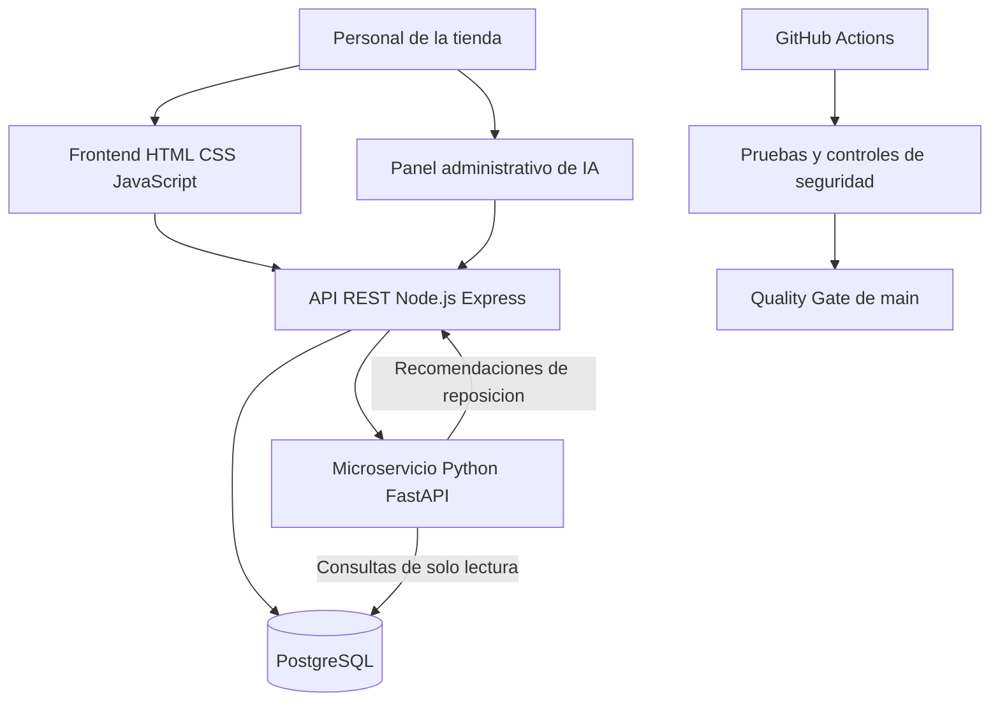
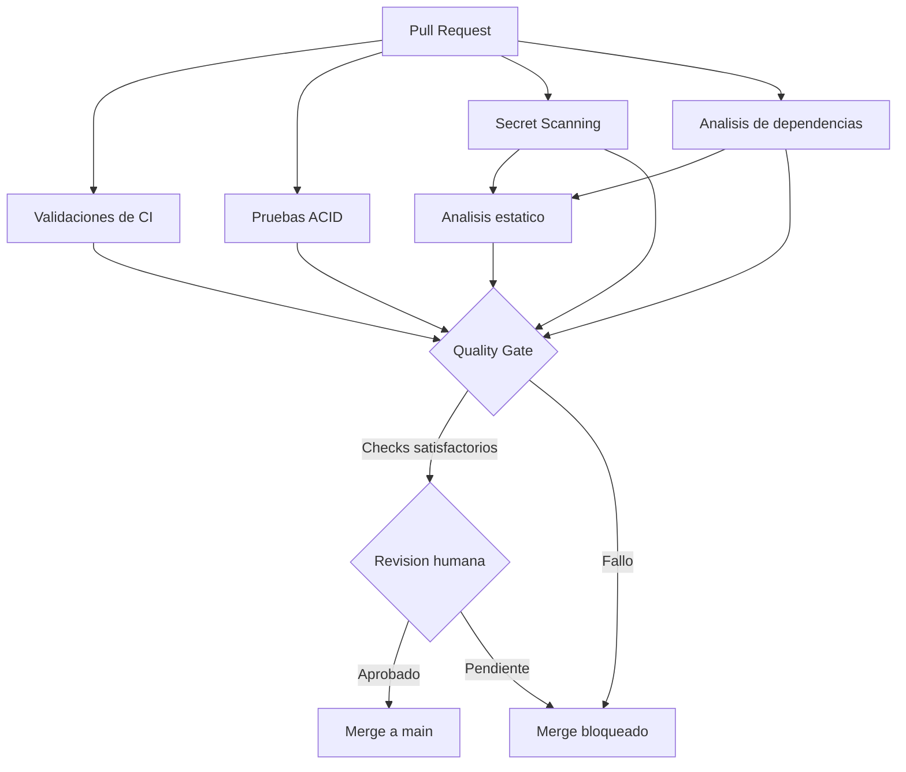

# ATELIER — ERP para Tienda de Ropa


ATELIER es un sistema transaccional tipo ERP (Enterprise Resource Planning)
orientado a la gestión integral de una tienda de ropa.

El proyecto integra operaciones de venta, control de inventario, autenticación,
persistencia de datos y recomendaciones inteligentes de reposición, con énfasis
en la integridad transaccional, la seguridad y la trazabilidad.

Proyecto académico desarrollado en la Universidad Manuela Beltrán,
asignatura Sistema Transaccional, Grupo 6.

## Tabla de contenido

- [Alcance](#alcance)
- [Objetivo general](#objetivo-general)
- [Estado funcional](#estado-funcional)
- [Roles de usuario](#roles-de-usuario)
- [Arquitectura](#arquitectura)
- [Stack tecnológico](#stack-tecnológico)
- [Estructura del repositorio](#estructura-del-repositorio)
- [Instalación y ejecución](#instalación-y-ejecución)
- [API REST](#api-rest)
- [Inteligencia artificial](#inteligencia-artificial)
- [Integridad transaccional](#integridad-transaccional)
- [DevSecOps](#devsecops)
- [Evidencias](#evidencias)
- [Limitaciones](#limitaciones)
- [Metodología](#metodología)
- [Documentación](#documentación)
- [Autores](#autores)

## Alcance

Por indicación del docente durante la Guía 2, Fase III, ATELIER
se orienta exclusivamente como ERP de uso interno.

Las ventas se registran en un punto de venta físico por personal autorizado.
El comercio electrónico, las compras en línea y las cuentas de clientes
web quedan fuera del alcance funcional del proyecto.

La eliminación definitiva de las estructuras heredadas de comercio
electrónico se gestiona mediante el issue #16.

## Objetivo general

Desarrollar un sistema ERP que permita gestionar de manera eficiente
e integrada los procesos de una tienda de ropa, garantizando la
consistencia de la información, la integridad de las transacciones,
la seguridad de las operaciones y el apoyo a la toma de decisiones
mediante herramientas analíticas.

## Estado funcional

Estado de referencia: 19 de noviembre de 2026.

| Módulo | Funcionalidad | Estado |
|---|---|---|
| Autenticación | Inicio de sesión, tokens y revocación de sesiones | Integrado en backend |
| Autorización | Restricción de operaciones según rol | Integración parcial |
| Ventas POS | Registro transaccional y descuento de stock | Integrado en backend |
| Historial de ventas | Consulta de pedidos y detalles | Integrado en backend |
| Cancelación de ventas | Anulación, restitución de stock y movimientos | Integrado en backend |
| Inventario | Registro y consulta de movimientos | Integrado, con mejoras de seguridad pendientes |
| Catálogo | Consulta de productos, variantes y existencias | Pendiente de integración, PR #15 |
| Alertas de inventario | Consulta de stock mínimo | Disponible en fallback de IA; integración general pendiente |
| Compras | Modelo de proveedores, órdenes y recepción | Base de datos y prototipo |
| Auditoría | Bitácora de operaciones críticas | Pendiente de integración, PR #37 |
| Inteligencia artificial | Predicción de demanda y reposición por SKU | Integrado |
| Reportes gerenciales | Indicadores y analítica mediante Power BI | Planificado |
| Pruebas ACID | Validación automatizada de ventas y anulaciones | Integrado en CI |
| DevSecOps | Controles automáticos y protección de main | Configurado |

La interfaz principal incluye componentes de demostración.
La integración completa de las vistas con las operaciones
autenticadas del backend permanece en desarrollo.

## Roles de usuario

### Administrador

- Consultar información operativa.
- Registrar y consultar ventas.
- Anular ventas y restituir existencias.
- Ejecutar recomendaciones inteligentes de reposición.
- Gestionar el catálogo, inventario, compras y reportes
  conforme se integren los módulos correspondientes.

### Vendedor

- Iniciar sesión en el sistema.
- Registrar ventas en el punto de venta.
- Consultar su historial de ventas.
- Consultar la disponibilidad de productos en el módulo
  de inventario cuando finalice su integración.

El usuario vendedor no está autorizado para anular ventas
ni ejecutar el servicio administrativo de inteligencia artificial.

El rol cliente permanece como estructura heredada de la base
de datos, pendiente de eliminación o deshabilitación definitiva.

## Arquitectura

ATELIER implementa una arquitectura modular cliente-servidor,
separando las responsabilidades de presentación, lógica
transaccional, persistencia y análisis predictivo.



El backend principal es responsable de las operaciones
transaccionales y de la autorización de usuarios.

El microservicio de inteligencia artificial consulta los
datos mediante un rol PostgreSQL de solo lectura y no
modifica directamente las existencias ni los pedidos.

## Stack tecnológico

| Capa | Tecnología |
|---|---|
| Frontend | HTML5, CSS3, JavaScript |
| Backend | Node.js 20, Express 4 |
| Base de datos | PostgreSQL 16, versión validada en CI |
| Autenticación | Bearer tokens, PostgreSQL, SHA-256 y pgcrypto |
| Microservicio analítico | Python 3.10+, FastAPI, Uvicorn |
| Machine Learning | Scikit-learn, NumPy |
| Pruebas backend | Jest 30, Supertest 7 |
| Pruebas Python | Pytest |
| Control de versiones | Git, GitHub |
| Integración continua | GitHub Actions |
| Seguridad | TruffleHog, npm audit, CodeQL |
| Diagramación | PlantUML, Mermaid |
| Analítica gerencial planificada | Microsoft Power BI |

## Estructura del repositorio

```text
ST_G6_ATELIER/
├── .github/
│   ├── workflows/
│   │   ├── ci.yml
│   │   └── devsecops-pipeline.yml
│   ├── CODEOWNERS
│   └── dependabot.yml
├── docs/
│   ├── analisis-y-diseno-ATELIER.md
│   ├── diagrams/
│   └── prototipo/
├── db/
│   ├── schema.sql
│   ├── seed.sql
│   ├── migrations/
│   │   ├── 001_cancelacion_venta.sql
│   │   ├── 002_sesiones.sql
│   │   └── 004_ai_readonly.sql
│   └── fixtures/
│       └── ventas_ia_demo.sql
├── backend/
│   ├── server.js
│   ├── package.json
│   ├── package-lock.json
│   ├── .env.example
│   ├── src/
│   │   ├── config/
│   │   ├── middleware/
│   │   └── routes/
│   └── test/
│       └── acid.integration.test.js
├── frontend/
│   ├── index.html
│   ├── ia.html
│   ├── ia.js
│   ├── README.md
│   └── src/
├── ai-service/
│   ├── main.py
│   ├── model.py
│   ├── database.py
│   ├── requirements.txt
│   ├── .env.example
│   ├── README.md
│   └── tests/
├── test/
│   ├── run-acid.sh
│   ├── testCancelacion.sh
│   └── README.md
└── README.md
```

## Instalación y ejecución

### Requisitos previos

- Git.
- Node.js 20 y npm.
- PostgreSQL 16 y cliente psql.
- Python 3.10 o superior para el microservicio de IA.
- Bash para las pruebas automatizadas.

### 1. Clonar el repositorio

```bash
git clone https://github.com/JCbral04/ST_G6_ATELIER.git
cd ST_G6_ATELIER
```

### 2. Configurar PostgreSQL

Configurar el host, puerto y usuario de acuerdo con
la instalación local.

```bash
export PGHOST=127.0.0.1
export PGPORT=5432
export PGUSER=postgres
```

Si PostgreSQL utiliza otro puerto, ajustar PGPORT.
Por ejemplo, 5433 en algunas instalaciones locales.

Para una instalación nueva:

```bash
psql -d postgres -v ON_ERROR_STOP=1 -f db/schema.sql
psql -d atelier_db -v ON_ERROR_STOP=1 -f db/seed.sql
```

El esquema crea la base de datos atelier_db.
El seed incorpora catálogos, usuarios y transacciones
de demostración.

No volver a ejecutar estos comandos indiscriminadamente
sobre bases existentes.

### 3. Aplicar migraciones

Desde la raíz del repositorio:

```bash
for f in db/migrations/*.sql; do
  psql -d atelier_db \
    -v ON_ERROR_STOP=1 \
    --single-transaction \
    -f "$f" || break
done
```

Si alguna migración falla, detener la instalación y
resolver el error antes de iniciar el backend.

| Migración | Responsabilidad |
|---|---|
| 001 | Restitución automática de stock al cancelar ventas |
| 002 | Sesiones autenticadas y revocables |
| 004 | Rol de acceso restringido para inteligencia artificial |

La migración 003 corresponde al módulo de auditoría,
cuya integración permanece pendiente al momento
de esta documentación.

### 4. Instalar el backend

```bash
cd backend
npm ci
cp -n .env.example .env
chmod 600 .env
```

Configurar el archivo backend/.env con los valores
correspondientes al entorno local.

```dotenv
DB_HOST=127.0.0.1
DB_PORT=5432
DB_USER=postgres
DB_PASSWORD=
DB_NAME=atelier_db
PORT=3000
AI_SERVICE_URL=http://127.0.0.1:8000
AI_INTERNAL_KEY=
```

Completar DB_PASSWORD con la contraseña local,
sin incorporarla al control de versiones.

AI_INTERNAL_KEY debe configurarse cuando se utilice
el microservicio predictivo.

Iniciar Express:

```bash
npm run dev
```

### 5. Acceder a la interfaz

| Recurso | Dirección |
|---|---|
| Interfaz principal | http://localhost:3000/ |
| Estado de la API | http://localhost:3000/api/health |
| Panel independiente de IA | http://localhost:3000/ia.html |

Verificar la conexión con PostgreSQL:

```bash
curl http://localhost:3000/api/health
```

Respuesta esperada:

```json
{
  "api": "ATELIER operativa",
  "base_de_datos": true
}
```

Para conocer el funcionamiento de las vistas y el modo
de demostración, consultar [frontend/README.md](frontend/README.md).

### 6. Usuarios de demostración

| Usuario | Rol |
|---|---|
| admin@atelier.com | Administrador |
| vendedor@atelier.com | Vendedor |

La contraseña inicial del seed es 123456.

Estas credenciales son exclusivamente para entornos
académicos aislados y no deben utilizarse en producción.

La interfaz principal todavía utiliza mecanismos de
demostración que no equivalen a una sesión real del backend.
El panel independiente de IA sí utiliza la autenticación
de la API.

## API REST

Endpoints integrados en main al 19 de noviembre de 2026.

| Método | Endpoint | Autorización |
|---|---|---|
| GET | /api/health | Pública |
| POST | /api/auth/login | Credenciales válidas |
| GET | /api/auth/me | Sesión válida |
| POST | /api/auth/logout | Sesión válida |
| GET | /api/pedidos | Vendedor o administrador |
| GET | /api/pedidos/:id | Vendedor propietario o administrador |
| POST | /api/pedidos | Vendedor o administrador |
| POST | /api/pedidos/:id/cancelar | Administrador |
| GET | /api/inventario/movimientos | Autenticación pendiente |
| POST | /api/inventario/movimientos | Autenticación pendiente; validación de rol mediante ID recibido |
| POST | /api/ia/reposicion | Administrador |

Las rutas de ventas y reposición requieren una cabecera
Authorization con un Bearer token válido.

Las rutas de movimientos requieren endurecimiento
de autenticación y atribución del usuario.
Esta corrección se encuentra identificada en la auditoría
del PR #37.

Las rutas de catálogo e inventario general se gestionan
mediante el PR #15.

## Inteligencia artificial

ATELIER incorpora un microservicio de predicción de
demanda por SKU y recomendaciones de reposición.

Fue implementado mediante FastAPI y Scikit-learn e
integrado al backend principal mediante una API interna.

### Estrategia predictiva

| Historial disponible | Estrategia |
|---|---|
| 21 días o más | Regresión Ridge |
| Entre 7 y 20 días | Suavizado exponencial |
| Menos de 7 días | Estimación por categoría o historial parcial |
| Información insuficiente | Umbral estático |

La regresión Ridge incorpora medias móviles exponenciales
de 7 y 14 días y características del día de la semana.

La evaluación predictiva utiliza una separación temporal
de los últimos siete días del historial.

### Resultados generados

- Demanda diaria estimada.
- Stock de seguridad.
- Punto de reorden.
- Días de cobertura.
- Riesgo de desabastecimiento.
- Cantidad sugerida de reposición.
- Consideración de mercancía en tránsito.
- Exclusión de ventas canceladas.

Las recomendaciones son informativas y requieren
validación humana. No generan compras automáticamente.

### Seguridad y tolerancia a fallos

- Rol PostgreSQL de solo lectura.
- Autorización exclusiva para administradores.
- Clave interna compartida entre servicios.
- Tiempo máximo de espera HTTP de 3000 ms.
- Limitación de solicitudes.
- Fallback a alertas estáticas cuando FastAPI no está disponible.

El modo estático se identifica explícitamente y no se
presenta como una predicción de Machine Learning.

### Instalación del microservicio

La instalación detallada, configuración de variables,
creación de atelier_demo y carga del historial sintético
se encuentran en la [documentación del microservicio](ai-service/README.md).

El backend y el microservicio deben consultar la misma
base de datos para garantizar coherencia en las recomendaciones.

### Resultados experimentales

Experimento realizado el 19 de noviembre de 2026:

- 140 ventas sintéticas.
- 350 unidades vendidas.
- 35 días históricos por SKU.
- 4 variantes evaluadas.
- Horizonte de predicción de 15 días.
- Tiempo de entrega supuesto de 7 días.

| SKU | Stock | Demanda diaria | Cobertura en días | Riesgo | Reposición sugerida |
|---|---:|---:|---:|---|---:|
| CAM-NEG-M | 68 | 2.424 | 28.06 | Bajo | 0 |
| CAM-BLA-M | 40 | 2.453 | 16.31 | Bajo | 2 |
| JEA-AZU-32 | 30 | 2.583 | 11.61 | Medio | 14 |
| CHA-AZU-L | 15 | 2.552 | 5.88 | Crítico | 29 |

Total recomendado: 45 unidades.

El experimento demuestra el funcionamiento del
prototipo predictivo sobre datos sintéticos.
No constituye una validación comercial del modelo.

### Pruebas del microservicio

Desde ai-service, con el entorno virtual activado:

```bash
python -m pytest -v
```

Resultados registrados:

- 8 pruebas automatizadas Python satisfactorias.
- 7 comprobaciones de integración y autorización satisfactorias.
- Acceso sin clave interna rechazado.
- Acceso de vendedor al análisis predictivo rechazado.
- Permisos de escritura del rol analítico denegados
  sobre las tablas verificadas.
- Fallback y recuperación del microservicio exitosos.

## Integridad transaccional

Las operaciones críticas de venta y cancelación utilizan
transacciones PostgreSQL y mecanismos de bloqueo de filas.

El sistema aplica BEGIN, COMMIT y ROLLBACK para mantener
la consistencia de las operaciones.

### Propiedades ACID

| Propiedad | Implementación |
|---|---|
| Atomicidad | Confirmación completa o rollback de la operación |
| Consistencia | Restricciones, claves foráneas, validaciones y triggers |
| Aislamiento | Bloqueo de registros mediante SELECT FOR UPDATE |
| Durabilidad | Persistencia de transacciones confirmadas en PostgreSQL |

### Suite automatizada

La suite utiliza Jest, Supertest, rutas reales de Express
y una instancia real de PostgreSQL.

| ID | Caso de prueba | Resultado local |
|---|---|---|
| ACID-01 | Venta exitosa y descuento atómico de stock | PASS |
| ACID-02 | Rollback ante fallo intermedio | PASS |
| ACID-03 | Ventas concurrentes de la última unidad | PASS |
| ACID-04 | Cancelación y restitución de existencias | PASS |

Las pruebas crean una base de datos temporal, cargan
el esquema, los datos iniciales y las migraciones.

La base temporal se elimina al finalizar la ejecución.
Las bases operativas no se utilizan como objetivos
de estas pruebas.

### Ejecutar las pruebas

Instalar las dependencias del backend mediante npm ci.

Configurar las variables DB_HOST, DB_PORT, DB_USER
y DB_PASSWORD en el entorno de ejecución.

Desde la raíz:

```bash
bash test/run-acid.sh
```

El usuario de pruebas necesita permisos para crear y
eliminar la base temporal y aplicar las migraciones.

### Validación mediante mutación controlada

Se eliminó temporalmente BEGIN de la operación de venta
para evaluar la capacidad de la suite de detectar
regresiones transaccionales.

| Ejecución | PASS | FAIL | Duración |
|---|---:|---:|---:|
| Código original | 4 | 0 | 14.18 s |
| Mutación controlada | 2 | 2 | 15.12 s |
| Código restaurado | 4 | 0 | 12.287 s |

La prueba detectó pérdida de atomicidad y un cambio
incorrecto en las respuestas de ventas concurrentes.

El código mutado no se incorporó al repositorio.

Documentación completa: [test/README.md](test/README.md).

## DevSecOps

El repositorio integra controles automatizados de calidad
y seguridad mediante GitHub Actions.

### Workflows

| Workflow | Responsabilidad |
|---|---|
| ci.yml | Backend y validación del esquema PostgreSQL |
| devsecops-pipeline.yml | Seguridad, pruebas ACID y etapa de despliegue |

### Quality Gate

Desde el 19 de noviembre de 2026, la rama main
cuenta con un Ruleset activo que exige seis checks:

| Check obligatorio | Propósito |
|---|---|
| Build y pruebas — Backend (Node.js) | Instalación y validaciones configuradas del backend |
| Validación de esquema — PostgreSQL | Carga del esquema y seed |
| Pruebas ACID — PostgreSQL y Jest | Integridad transaccional |
| Secret Scanning | Detección de secretos verificados |
| Software Composition Analysis (SCA) | Auditoría de dependencias |
| Static Application Security Testing (SAST) | Análisis estático mediante CodeQL |

Adicionalmente:

- Una aprobación humana obligatoria.
- Protección contra eliminación de main.
- Protección contra force push.
- Ausencia de actores autorizados para omitir el Ruleset.
- Dependabot para mantenimiento de dependencias.

[Consultar Ruleset #25360630](https://github.com/JCbral04/ST_G6_ATELIER/rules/25360630).



La política de actualización estricta respecto a main
permanece desactivada. Las aprobaciones no se invalidan
automáticamente con cada nuevo commit.

Por este motivo, el equipo debe actualizar las ramas
y revisar los cambios antes de efectuar un merge.

### Auditoría de dependencias

Resultados verificados el 19 de noviembre de 2026:

| Indicador | Resultado |
|---|---:|
| Vulnerabilidades críticas reportadas | 0 |
| Vulnerabilidades altas reportadas | 0 |
| Vulnerabilidades moderadas de desarrollo | 18 |
| Vulnerabilidades reportadas en dependencias de producción | 0 |

Las observaciones moderadas se documentan como deuda
técnica del entorno de pruebas, principalmente en
dependencias transitivas de Jest.

No se aplican actualizaciones incompatibles mediante
npm audit fix --force sin evaluar su impacto.

## Evidencias

Resultados técnicos consolidados sobre el commit
a136b50 de main.

| Evidencia | Referencia |
|---|---|
| Cancelación transaccional | [Issue #25](https://github.com/JCbral04/ST_G6_ATELIER/issues/25) |
| Implementación de inteligencia artificial | [PR #38](https://github.com/JCbral04/ST_G6_ATELIER/pull/38) |
| Automatización ACID | [PR #39](https://github.com/JCbral04/ST_G6_ATELIER/pull/39) |
| Integridad transaccional | [Issue #28](https://github.com/JCbral04/ST_G6_ATELIER/issues/28) |
| Pipeline CI consolidado | [Ejecución CI](https://github.com/JCbral04/ST_G6_ATELIER/actions/runs/44628345922) |
| Pipeline DevSecOps consolidado | [Ejecución DevSecOps](https://github.com/JCbral04/ST_G6_ATELIER/actions/runs/44628345984) |
| Job de pruebas ACID | [Resultado ACID](https://github.com/JCbral04/ST_G6_ATELIER/actions/runs/44628345984/job/135928032454) |
| Protección de rama | [Ruleset activo](https://github.com/JCbral04/ST_G6_ATELIER/rules/25360630) |
| Commit de referencia | [a136b50](https://github.com/JCbral04/ST_G6_ATELIER/commit/a136b50fa1f26848b3a3fe9cfeab23db1caf2811) |

En el commit de referencia, los workflows CI y DevSecOps
finalizaron satisfactoriamente.

La etapa de despliegue es un placeholder académico.
Su ejecución exitosa no acredita un despliegue real
en producción.

## Limitaciones

- Integración completa del frontend con autenticación
  y operaciones reales del backend pendiente.
- Catálogo y alertas generales pendientes de integración.
- Autenticación y atribución de movimientos manuales
  de inventario pendientes de corrección.
- Bitácora general de auditoría pendiente de integración.
- Eliminación definitiva de estructuras y usuarios
  heredados del comercio electrónico pendiente.
- Operaciones completas de compras y proveedores pendientes.
- Integración con Power BI planificada.
- Modelo predictivo evaluado mediante datos sintéticos.
- No se corrige la demanda censurada por desabastecimiento.
- No se generan órdenes de compra automáticamente.
- Pruebas Python todavía no incorporadas al Quality Gate.
- La prueba de concurrencia no fuerza de manera
  determinista el solapamiento transaccional.
- No existe un despliegue real de producción acreditado.
- Vulnerabilidades moderadas del entorno de desarrollo
  pendientes de actualización.

Estas limitaciones delimitan el alcance del prototipo
y constituyen oportunidades de mejora posterior.

## Metodología

El proyecto se desarrolla bajo el modelo de ciclo de vida
en cascada del software (SDLC).

| Fase | Actividades |
|---|---|
| Planificación | Alcance, factibilidad, riesgos, costos y cronograma |
| Análisis y diseño | Requisitos, casos de uso, arquitectura y modelo relacional |
| Construcción inicial | Esquema, datos iniciales y prototipo |
| Implementación | Backend, frontend, transacciones e inteligencia artificial |
| Pruebas | Validación funcional, integridad, seguridad e integración |
| Documentación y entrega | Consolidación del Documento Maestro y evidencias |

La gestión colaborativa utiliza ramas de desarrollo,
issues, pull requests, revisión de código y validaciones
automáticas antes de la integración.

## Documentación

- [Análisis y diseño](docs/analisis-y-diseno-ATELIER.md)
- [Diagramas UML y modelo de datos](docs/diagrams/)
- [Prototipo de interfaz](docs/prototipo/index.html)
- [Documentación del frontend](frontend/README.md)
- [Documentación de inteligencia artificial](ai-service/README.md)
- [Documentación de pruebas ACID](test/README.md)
- [Issues del proyecto](https://github.com/JCbral04/ST_G6_ATELIER/issues)
- [Pull Requests](https://github.com/JCbral04/ST_G6_ATELIER/pulls)

Las evidencias y resultados técnicos se utilizan
como insumos para la consolidación de las
Guías 7 y 8 del proyecto académico.

## Autores

- Juan Esteban Cabral Bautista
- Laura Valentina Ruiz Vaca
- Steven Rusinque Gutierrez

Universidad Manuela Beltrán

Sistema Transaccional — Grupo 6

2026
